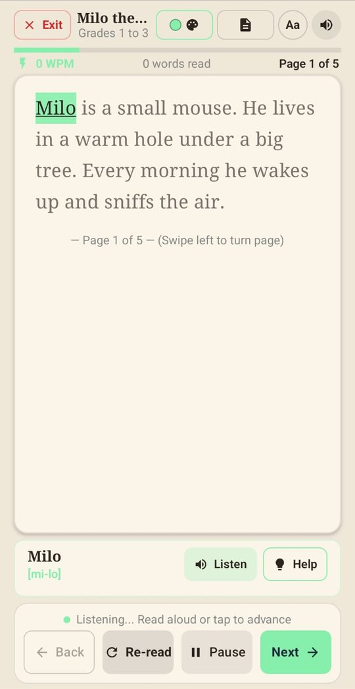
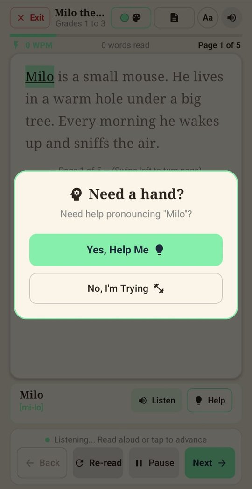
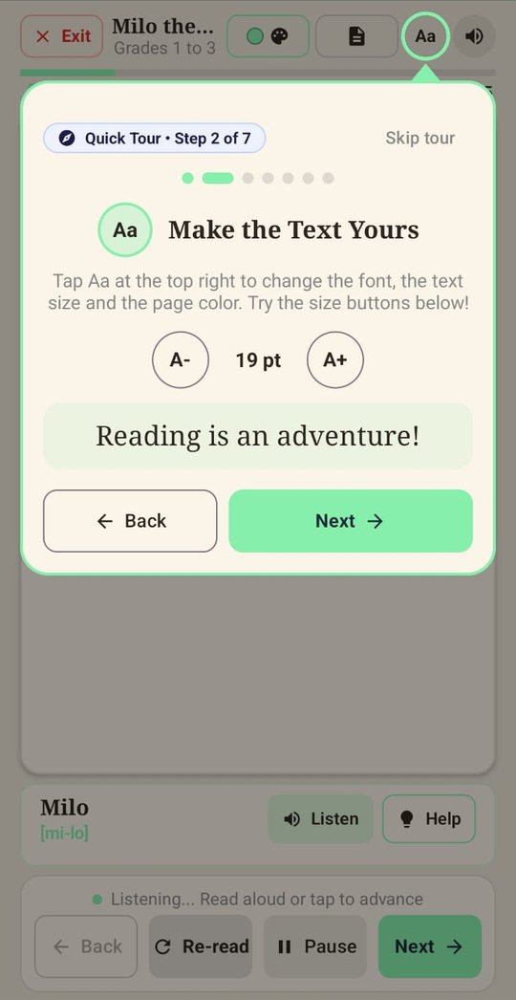
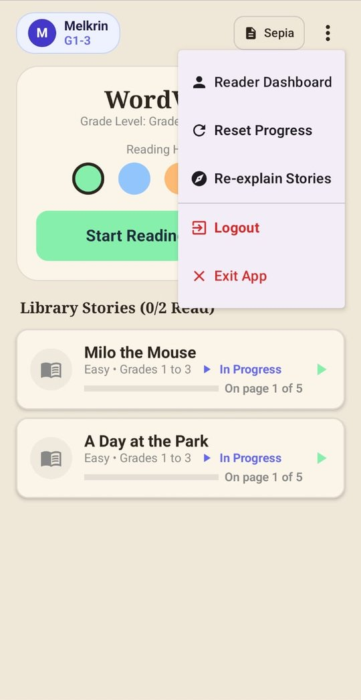
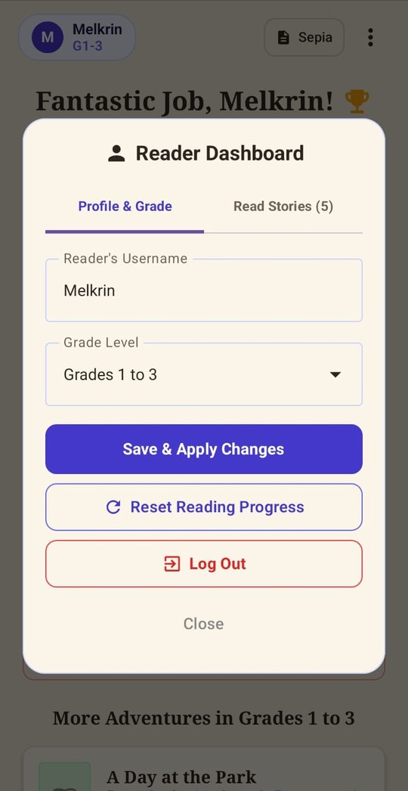
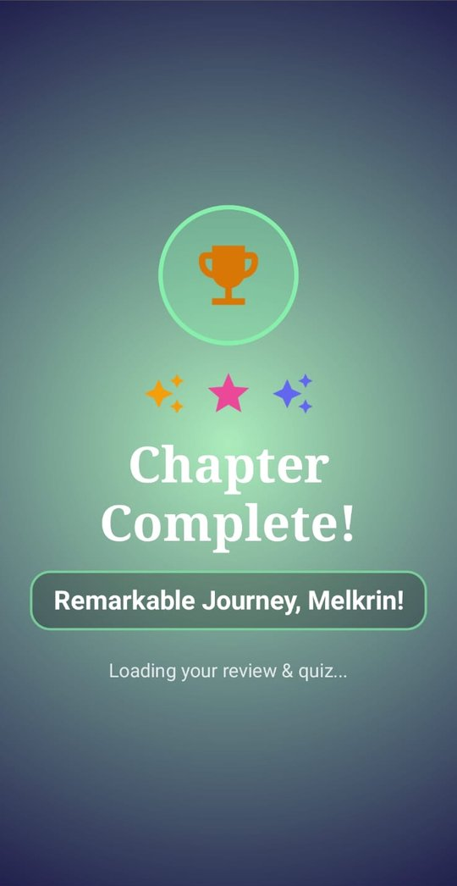
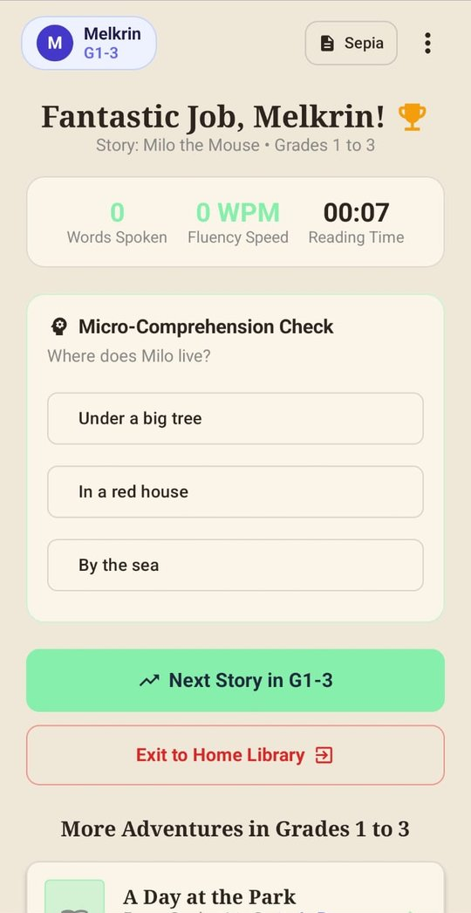

# WordVoyage 📖


**WordVoyage is an Android reading app that helps children read aloud, one word at a time.**
It listens to the child, highlights each word as it is read, offers help when the child gets stuck, and finishes every story with a short comprehension check.

<p align="center">
  
  
  
  
</p>

> 🔀 **Two versions of this app exist.**
> This repository loads stories from a **JSON file** (works offline).
> The **[Firestore version](https://github.com/Lourdusmel-16/WordVoyage-Firestore)** loads stories from **Cloud Firestore** (add or edit stories without releasing a new app).
> See [Which version should I use?](#-which-version-should-i-use) below.

---

## ✨ Features

| | |
|---|---|
| 🎯 **Word-by-word reading** | The highlight follows the child's voice using on-device speech recognition (Sherpa-ONNX). Tapping also moves on. |
| 📚 **Four grade levels** | Grades 1–3, 4–5, 6–8 and 9–12, each with its own stories. |
| 🔍 **Long-press for meaning** | Press and hold any word to see its dictionary meaning. Reading pauses while the box is open. |
| 🆘 **Smart help popup** | After **6 seconds** on one word, a friendly "Need a hand?" box appears, leading to a Pronunciation Helper (slow 0.6x playback, skip, or try again). |
| 🔊 **Read aloud** | Text-to-speech can read the page to the child. |
| 📝 **Comprehension check** | A short multiple-choice question after every story, with live stats: words spoken, fluency (WPM) and reading time. |
| 🎉 **Celebration screen** | A "Chapter Complete!" reward after each story. |
| 📊 **Reader dashboard** | Change username and grade, see read stories, reset progress, or log out. Progress is saved per user in Firebase. |
| 🎨 **Reader settings** | Dyslexia-friendly font, text size, Sepia / Day / Night pages and five highlight colours. |
| 🧭 **Interactive guide** | A 7-step first-time tour with try-it boxes. Re-open it any time from **Re-explain Stories**. |

## 📸 Screenshots

<table align="center">
  <tr>
    <td align="center" width="20%"><br><sub><b>Home library</b></sub></td>
    <td align="center" width="20%"><br><sub><b>Reading</b></sub></td>
    <td align="center" width="20%"><br><sub><b>Long-press meaning</b></sub></td>
    <td align="center" width="20%"><br><sub><b>Help after 6 s</b></sub></td>
    <td align="center" width="20%"><br><sub><b>Pronunciation helper</b></sub></td>
  </tr>
  <tr>
    <td align="center"><br><sub><b>Interactive guide</b></sub></td>
    <td align="center"><br><sub><b>Menu</b></sub></td>
    <td align="center"><br><sub><b>Reader dashboard</b></sub></td>
    <td align="center"><br><sub><b>Chapter complete</b></sub></td>
    <td align="center"><br><sub><b>Comprehension check</b></sub></td>
  </tr>
</table>

---

## 🔀 Which version should I use?

| | **JSON version** (this repo) | **[Firestore version](https://github.com/Lourdusmel-16/WordVoyage-Firestore)** |
|---|---|---|
| Where stories live | `app/src/main/assets/stories.json` inside the app | `stories` collection in Cloud Firestore |
| Adding / fixing a story | Edit the JSON, then release a new app version | Edit in Firebase or the in-app admin screen. **Every user gets it instantly, no app update** |
| Works offline | ✅ Stories always load | ⚠️ Needs internet to fetch stories |
| Speed on start | ⚡ Instant (local file) | Slightly slower (network request) |
| Firestore read cost | None for stories | Counts toward Firestore reads and quota |
| Story history | ✅ Tracked in Git, with diffs and rollbacks | Lives in the database only |
| Admin "add story" | Saved on that device only | ✅ Saved to the cloud, visible to everyone |
| Best for | A fixed story library, poor internet, demos | A growing library managed by teachers or admins |

**Advantages of the Firestore version:** live content updates, admin uploads reach every device, no rebuild for typo fixes or new stories, a smaller APK, and one source of truth.

**Advantages of this JSON version:** works offline, simple and free (no read costs for stories), content is version-controlled in Git, and stories load instantly with no network errors.

👉 Want cloud-managed stories? **[Open the Firestore version →](https://github.com/Lourdusmel-16/WordVoyage-Firestore)**

---

## 🧠 How it works

```
          ┌───────────────────────┐
          │  assets/stories.json  │  ← story library (this version)
          └───────────┬───────────┘
                      ▼
 Child ──► Reading screen ──► Speech recognition + text-to-speech
                      │
                      ▼
          ┌───────────────────────┐
          │   Firebase            │  Authentication (sign-in)
          │   users/{uid}         │  + Firestore (progress, admin flag)
          └───────────────────────┘
```

- **Stories** are read from `stories.json`. Stories added by an admin inside the app are kept in `added_stories.json` on that device and merged in.
- **Accounts and progress** (finished stories, last word per page) live in Firebase, keyed by each story's `id`.
- **Admin passcode** is not in the code or the APK. It is stored in a private Firestore document and checked by Firestore security rules, so you can change it without an app update.
- **Word meanings** come from the free [dictionaryapi.dev](https://dictionaryapi.dev) service and need internet.

### Adding a story

Add an object to `app/src/main/assets/stories.json`:

```json
{
  "id": "story_the_little_fox",
  "title": "The Little Fox",
  "gradeLevel": "Grades 1 to 3",
  "ageGroup": "GRADES_1_3",
  "difficulty": "Easy",
  "order": 9,
  "screens": [
    "Page one text goes here.",
    "Page two text goes here."
  ],
  "quiz": {
    "question": "What did the fox find?",
    "options": ["A key", "A lantern", "A map"],
    "correctIndex": 1
  }
}
```

- `ageGroup` must be one of `GRADES_1_3`, `GRADES_4_5`, `GRADES_6_8`, `GRADES_9_12`.
- `id` must be unique and **never changed**, because saved progress is stored under it.
- `order` sets the position in the story list.

---

## 🚀 Getting started

Full, step-by-step instructions are in **[docs/SETUP.md](docs/SETUP.md)**. In short:

1. Clone the repo and open it in Android Studio.
2. Create a Firebase project, enable **Email/Password** sign-in and **Firestore**.
3. Put your own `google-services.json` in `app/` (it is git-ignored on purpose).
4. Create the admin passcode document and publish the security rules.
5. Add the speech-recognition model files to `app/src/main/assets/sherpa-model/`.
6. Run on a real Android device and allow the microphone.

**Tests:** `./gradlew testDebugUnitTest`
**CI:** every push builds the app and runs the unit tests on GitHub Actions. Add a repository secret named `GOOGLE_SERVICES_JSON` containing the full text of your `google-services.json`.

---

## 🗂️ Project structure

```
app/src/main/
├── assets/
│   ├── stories.json               # story library
│   └── sherpa-model/              # speech model (you add this, see docs/SETUP.md)
└── java/com/sample/readingapp/
    ├── MainActivity.kt
    ├── data/        # Story, AgeGroup, StoryRepository, word meanings
    ├── speech/      # Sherpa speech recognition, text-to-speech
    ├── theme/       # colours, fonts, reader themes
    ├── util/        # text helpers, app config
    └── ui/
        ├── auth/        # sign-in and sign-up
        ├── intro/       # splash and welcome
        ├── home/        # grade and story list
        ├── reader/      # reading screen, guide, quiz, celebration
        └── components/  # dialogs and shared widgets
```

## 🛠️ Tech stack

Kotlin · Jetpack Compose · Material 3 · Firebase Authentication · Cloud Firestore · Sherpa-ONNX (speech recognition) · Android TextToSpeech · Gson · JUnit · GitHub Actions

## 🗺️ Roadmap

- [ ] Sync admin-added stories across devices in the JSON version
- [ ] More stories per grade level
- [ ] Reading-speed and accuracy reports for teachers
- [ ] More languages

## 🤝 Contributing

Suggestions and pull requests are welcome. Please open an issue first to discuss big changes.

## 📄 License

Released under the MIT License. See [LICENSE](LICENSE).

## 👤 Author

**Lourdus Rogin Melkrin S**
[GitHub](https://github.com/Lourdusmel-16) · [LinkedIn](https://www.linkedin.com/in/lourdus-rogin-melkrin-s)
